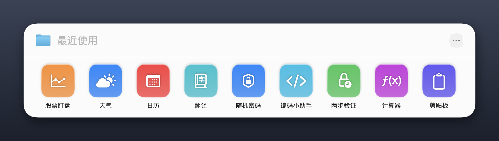
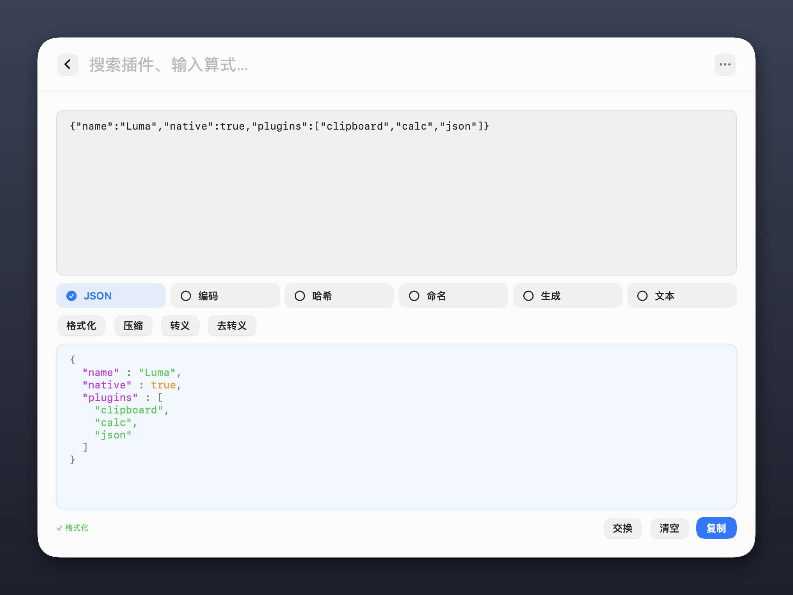
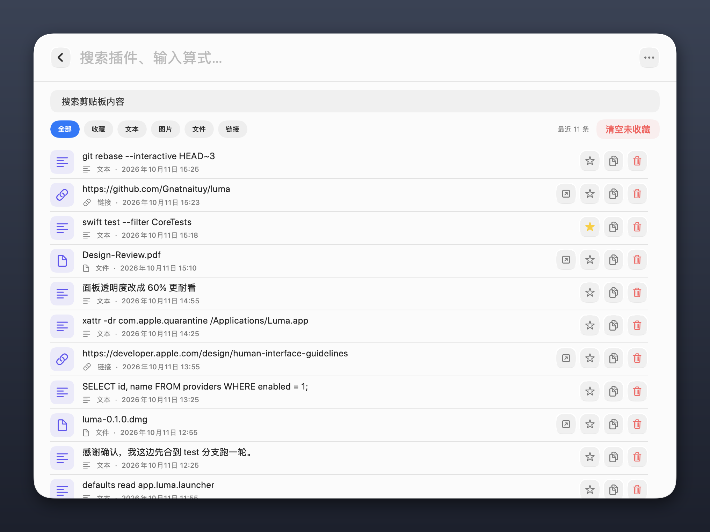
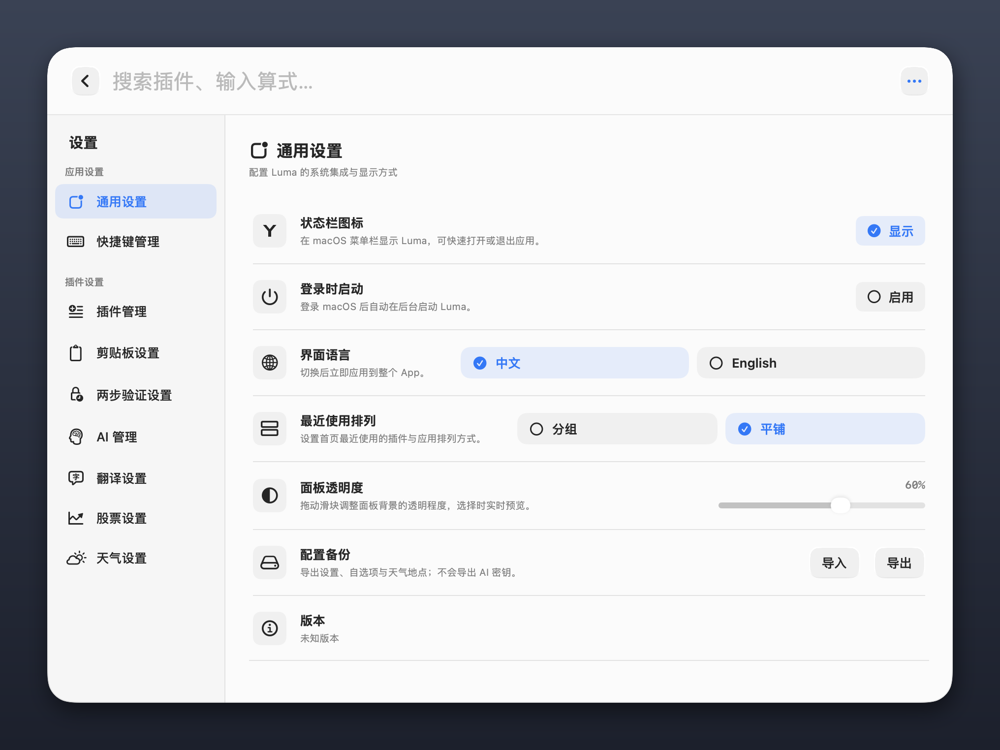

<p align="center">
  
</p>

<h1 align="center">Luma</h1>

<p align="center"><strong>轻量、原生、随叫随到的 macOS 工具启动器。</strong></p>

<p align="center">
  
  
  
</p>

<p align="center">
  <a href="#安装">安装</a> ·
  <a href="#内置插件">插件</a> ·
  <a href="#基本操作">操作</a> ·
  <a href="#隐私与本地数据">隐私</a> ·
  <a href="#开发">开发</a>
</p>

按 `⌥Space` 唤起一个浮动面板，搜 App、搜文件、算数、翻剪贴板历史、取验证码都在同一个输入框里完成。纯 Swift + SwiftUI + AppKit，没有 Electron、WebView 或 JavaScript 运行时。



## 安装

从 [Releases](https://github.com/Gnatnaituy/luma/releases/latest) 下载 DMG，把 **Luma.app** 拖进「应用程序」。

首次打开会被 macOS 拦下，提示「无法验证开发者」或「已损坏」。应用使用 ad-hoc 签名、未经 Apple 公证，这是预期行为，不是文件损坏。任选一种方式放行：

- 在「应用程序」里右键点击 Luma → 选择「打开」→ 在弹窗里再点「打开」；
- 或打开「终端」执行 `xattr -dr com.apple.quarantine /Applications/Luma.app`。

Luma 常驻菜单栏，默认快捷键 `⌥Space`，退出入口在菜单栏图标里。首次使用粘贴、读取选中文本或窗口管理前，需要在「系统设置 → 隐私与安全性 → 辅助功能」中启用它。

### 从源码安装

```bash
git clone https://github.com/Gnatnaituy/luma.git
cd luma
./scripts/install-app.sh      # 构建、签名并替换 /Applications/Luma.app
./scripts/build-dmg.sh        # 打出可分发的通用二进制 DMG
```

需要 macOS 14.4 或更高版本，以及 Swift 6.0+（Xcode 16 或 Command Line Tools 16）。

只有 Command Line Tools 时，当前 SDK 的 SwiftUI 把 `@State` 这类属性做成了宏，展开需要 Xcode 才提供的宏插件；构建与测试脚本会自动改用仍以属性包装器实现它们的已安装 SDK（见 `scripts/select-sdk.sh`），装上 Xcode 后这一步自动跳过。

## 内置插件

| 插件 | 能力 |
| --- | --- |
| 剪贴板 | 文本、图片、文件和链接历史；搜索、过滤、收藏与快速粘贴 |
| 计算器 | 安全解析四则运算、括号、幂和常用函数，并保存最近结果 |
| 随机密码 | 使用系统安全随机数生成 6–32 位密码 |
| 两步验证 | 生成 TOTP 动态口令；二维码截图与导出文件批量导入，密钥保存在钥匙串 |
| 翻译 | Apple Translation 或用户配置的 AI 模型翻译 |
| 编码小助手 | JSON 高亮与格式化、Base64 / URL / Hex / Unicode 编解码、SHA 与 MD5 哈希、命名风格转换、UUID 与时间戳、行处理 |
| 股票盯盘 | 查询 A 股、港股、美股的公网延迟行情与多周期走势 |
| 天气 | 多地点天气、逐小时预报与七日预报 |
| 日历 | 查看公历、农历、节气、传统节日和内置年份的节假日安排 |
| 窗口管理 | 将当前窗口排列到左半屏、右半屏、最大化或居中 |

编码小助手把 28 个工具按 JSON / 编码 / 哈希 / 命名 / 生成 / 文本分页，输入与输出都带 JSON 语法高亮，结果可以一键「交换」回输入做连续处理：



剪贴板历史支持文本、图片、文件和链接；双击或 `Enter` 会隐藏 Luma、恢复原窗口并粘贴。图片条目默认按大图铺开显示，不用点开就能大致看清截图内容，也能在「剪贴板设置 → 图片预览」里切回紧凑缩略图。文本与链接全局去重，图片按内容哈希去重，默认保留 3 个月（收藏不受限）。两步验证支持 SHA-1 / SHA-256 / SHA-512 与自定义周期，二维码截图由系统 Vision 在本机解析，密钥只写入钥匙串。翻译优先取唤起前选中的文本，没有选中文本时再读剪贴板，中文默认译英、其他语言默认译中。



设置页分为「应用设置」与「插件设置」两组，可以启用停用插件、修改搜索关键词、绑定关键词快捷键，以及配置菜单栏图标、面板透明度、最近使用布局、登录时启动、语言和配置导入导出：



## 基本操作

| 操作 | 按键或方式 |
| --- | --- |
| 唤起或隐藏 Luma | `⌥ Space` |
| 移动选择 | `↑` / `↓` |
| 打开或执行 | `Enter` |
| 返回上一层 | `Esc` |
| 展开结果操作 | `→` |
| 打开上下文菜单 | 鼠标右键 |
| 翻译输入换行 | `Shift Enter` |
| 粘贴剪贴板条目 | `Enter` 或双击 |

搜索结果统一支持打开或复制，App 与文件还能复制路径并在 Finder 中显示。首页把最近打开的插件与 App 排成网格，可平铺混排或分组展示。全局快捷键与插件关键词都可以在设置里改；快捷键走 Carbon Hot Key，本身不需要辅助功能权限。

## 隐私与本地数据

Luma 只在使用对应能力时访问系统服务或网络：辅助功能用于粘贴、读取选中文本与窗口管理，钥匙串保存 AI API Key 与两步验证密钥，网络仅在请求股票、天气或用户自己配置的 AI 服务时使用。

| 数据 | 存储位置 |
| --- | --- |
| 剪贴板历史与图片 | `~/Library/Application Support/Luma/Clipboard`（不参与系统备份） |
| 插件与应用设置 | `UserDefaults` |
| AI API Key、两步验证密钥 | macOS 钥匙串 |

配置导出包含快捷键、插件设置、自选股票和天气地点，不包含钥匙串中的任何密钥。二维码只在本机用 Vision 识别，不会上传。只有选择 AI 翻译时，Luma 才会把待翻译文本发往用户配置的接口。

辅助功能授权与应用的身份和安装路径绑定，日常使用请保持 `/Applications/Luma.app`，避免重复授权或权限失效。

## 开发

```bash
./scripts/test-core.sh     # 完整测试套件（等价于 swift test）
./scripts/build-app.sh     # 生成本地签名的应用目录，产物在 dist/Luma.build
./scripts/build-app.sh --universal   # 同时编译 arm64 与 x86_64
```

项目使用 Swift Package Manager，不依赖任何第三方软件包。

```text
Sources/Luma/
├── AppDelegate.swift        # 生命周期、窗口与依赖装配
├── Launcher*.swift          # 启动器状态、搜索、会话与界面
├── Plugin.swift             # 插件类型与统一元数据（CommandCatalog）
├── *PluginView*.swift       # 各插件的原生 SwiftUI 界面
├── *Service.swift           # 日历、股票、天气与 AI 服务
├── Clipboard*.swift         # 剪贴板采集、粘贴与本地存储
├── SettingsView.swift       # 分类设置界面
└── Localization.swift       # 中文与 English 本地化

Tests/LumaTests/             # 核心、日历、性能与功能测试
scripts/                     # 构建、打包、安装与测试脚本
Resources/                   # Info.plist 与应用图标
docs/screenshots/            # README 截图
```

`CommandCatalog` 是插件元数据的唯一来源。插件都是编译期原生模块，不加载第三方网页或运行时插件代码。

## 已知限制

- 应用未经 Apple 公证，首次启动需要手动放行（见[安装](#安装)）。
- 股票和天气依赖公网服务，可能延迟、中断或受上游字段变化影响；自动模式会在失败时尝试其他来源。行情仅用于信息展示，不构成投资建议。
- 日历中的法定节假日与调休安排目前内置 2025、2026 年，其他年份仍显示周末、农历与传统节日；节气覆盖 2000–2099 年，且不推测调休。
